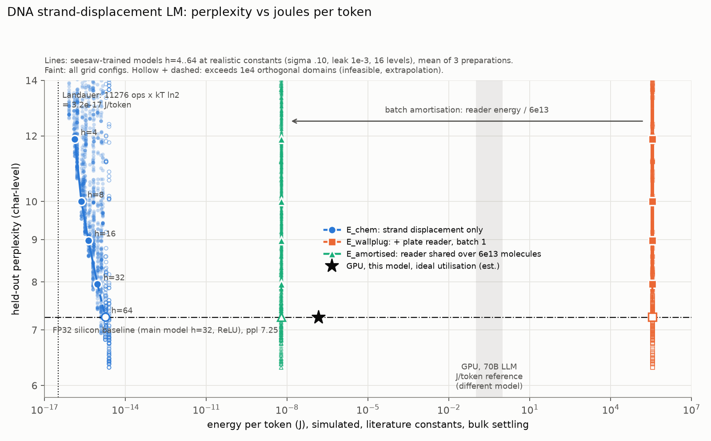
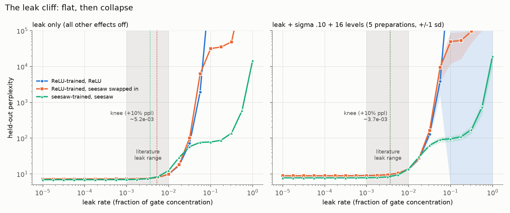

# DNA LLM simulator

A PyTorch simulator that runs a trained character-level language model as if it were a DNA strand-displacement circuit. It measures perplexity against joules per token under DNA chemistry. The argument it supports is in [`CASE_FOR_DNA.md`](CASE_FOR_DNA.md). **Everything here is simulation with literature-derived constants. Nothing was measured on a bench.**



## Rerun

```bash
python test_dna.py   # 10 substrate tests, including the identity test (~2 s)
python train.py      # 10 FP32 baselines: hidden 4..64 x {ReLU, seesaw}  (~85 s, CPU)
python sweep.py      # 6.7k configs x seeds, writes results/*.csv + summary.json (~80 s)
python plot.py       # results/frontier.png, results/leak_cliff.png
```

Plain PyTorch on CPU, seeded everywhere. The tiny Shakespeare text is downloaded to `data/`; if the file is missing, `model.py` falls back to a built-in text.

## Interactive explorer

`frontend/` is a static page that runs the trained models in the browser. `sim.js` is a JavaScript port of `dna.py`. You set pipetting error, leak, concentration levels, the seesaw gate, fuel, layout and copies per inference, and perplexity, the three energy accountings and strand feasibility are recomputed live on a 20,000-character held-out sample. The page also lets you sample text from the tube.

```bash
python frontend/export_web.py   # weights + sweep results -> frontend/data.js
node frontend/check_sim.js      # JS must match PyTorch on deterministic recipes (within 2e-6)
python3 -m http.server -d frontend 8000
```

Deployed on Vercel from this repo; `vercel.json` serves `frontend/` with no build step.

## What was built

| file | contents |
|---|---|
| `dna.py` | `DNAConfig` holds every physical constant in one place. `DNALinear` applies dual-rail split → quantisation to `n_levels` → log-normal pipetting error `w·exp(N(0,σ))` → leak ∝ total gate concentration, then accumulates energy and time counters. `SeesawActivation` computes `clamp(gain·(x−θ), 0, y_max)` with optional fuel depletion. Also the capacity check against `max_orthogonal_domains`, and the energy report. |
| `model.py` | Char MLP: one-hot context (6 chars × 33-symbol vocab) → hidden → 33 logits. A one-hot input is how a DNA circuit sees text (a strand per char-position is either present or absent), so `fc1` is an embedding fused with the hidden layer. |
| `train.py` | FP32 silicon training. ReLU models are rescaled (exactly, using ReLU homogeneity) so hidden activations sit in full-scale concentration units, which makes `y_max = 1` mean the same thing for every model. |
| `sweep.py` | Sweeps σ, leak, `n_levels`, model width, activation, fuel and architecture. Each seed is one physical preparation (one pipetting realisation). |
| `plot.py` | The two figures. |

## Headline numbers

Main model: hidden = 32, 7,457 parameters. "Realistic" means σ = 0.10, leak = 1e-3, 16 levels, seesaw activation; mean ± sd over 5 preparations.

| | perplexity |
|---|---|
| uniform guess | 33 |
| **FP32 silicon baseline (ReLU)**, the ceiling | **7.246** |
| FP32, same architecture trained with seesaw | 6.942 |
| DNA realistic, ReLU-trained, seesaw swapped in | 9.03 ± 0.33 |
| **DNA realistic, seesaw-trained** | **7.86 ± 0.20** |

| energy per token, h = 32, realistic | bulk (3600 s/layer) | localised origami (60 s/layer) |
|---|---|---|
| ops per token | 11,276 | 11,276 |
| Landauer floor for those ops (ops × kT ln 2) | 3.2e-17 J | 3.2e-17 J |
| **E_chem** (strand displacement only) | **9.3e-16 J** (29× Landauer) | 9.3e-16 J |
| **E_wallplug** (+ 50 W plate reader, batch 1) | **3.6e5 J** | 6.0e3 J |
| **E_amortised** (reader shared across 6e13 molecules) | **6.0e-9 J** | 1.0e-10 J |
| latency per token | 7,200 s | 120 s |
| GPU, same 7.5k-param model, ideal FP32 utilisation (est., 1e-11 J/FLOP) | 1.5e-7 J | |
| GPU, 70B LLM (reference only, different model) | 0.1–1 J | |

How to read this: the chemistry is within 29× of the thermodynamic floor. At batch 1 the plate reader makes DNA about 10¹² times worse than a GPU. Spread across a 6e13-molecule batch, it comes out 25× (bulk) to 1,500× (localised) below the GPU estimate for the same model. **That batch win only holds under the copies-per-inference assumption below.** DNA does not do interactive generation: a single token takes 2 hours in bulk and 2 minutes localised.

## Findings

**1. The leak cliff** (`results/leak_cliff.png`). With leak as the only effect, perplexity is flat up to ~1e-3 (7.27 at 1e-3, against 7.25 at zero leak). It rises 10% at **leak ≈ 5.2e-3** and doubles at ≈ 1.4e-2. Past 3e-2 it exceeds 100. With pipetting error and quantisation also on, the knee moves to ≈ 3.7e-3. **The literature leak range, 1e-3 to 1e-2, straddles the knee**, so leak control decides whether this works at all. Above the cliff, a seesaw-trained network degrades less catastrophically (ppl ~80–100 instead of 10³–10⁵), because saturation at `y_max` limits how much leak can pile up in the hidden layer.



**2. What the seesaw activation costs.** It costs essentially nothing.
- Swapping seesaw for ReLU in a trained ReLU model, all else equal, changes perplexity by −0.0003 on an ideal substrate and by −0.008 on the realistic one (well inside seed spread). Calibration puts `y_max` at the 99.9th percentile of training activations, so it rarely binds.
- Training with seesaw from the start does better than ReLU: FP32 6.94 vs 7.25. It is also more robust to noise. Under realistic chemistry it reaches 7.86 vs 9.03.
- The exception is leak. At leak = 1e-2 alone, the seesaw-trained model reaches ppl 12.5 vs 9.9 for the ReLU-trained one, so its knee comes earlier (3.6e-3 vs 5.2e-3).

**3. Ordering of effects at realistic values** (each effect alone, ReLU-trained → seesaw-trained, FP32 7.25 → 6.94):

| effect | ReLU-trained | seesaw-trained |
|---|---|---|
| quantisation, 16 levels | 8.26 | 7.42 |
| pipetting σ = 0.10 | 7.80 ± 0.12 | 7.32 ± 0.08 |
| leak 1e-3 | 7.27 | 6.99 |
| leak 1e-2 (top of the literature range) | 9.92 | 12.5 |

At typical values, quantisation is the largest cost. At the pessimistic end of its range, leak is the largest.

**4. Capacity ceiling.** Strands needed: h = 4 → ~1.1k, h = 8 → ~1.8k, h = 16 → ~3.1k, h = 32 → ~6.0k, h = 64 → ~12k. Against a 1e4-domain library, h = 64 is **infeasible**: it is drawn hollow and dashed in the frontier, even though its simulated perplexity under realistic chemistry (7.25) matches the FP32 baseline. Against a 1e3 library, *no* model here is feasible; the smallest one needs 1,063 strands.

**5. The dual-rail tax** is small in this accounting: 130 of 6,079 strands for h = 32. Splitting a signed weight into W⁺/W⁻ yields disjoint supports, so each weight still needs only one gate. The tax is the extra output rails and the annihilators. This is smaller than the "doubles the strand count" rule of thumb, which assumes dual-rail *inputs* as in Qian & Winfree's logic compilation. Our inputs (one-hot, seesaw outputs) are already non-negative, so they don't need it.

**6. Fuel depletion** (one tube reused across a stream of tokens). Tokens served before perplexity rises 10%: about 2,000 at a fuel budget of 1e3 full-scale releases per neuron, 8,000 at 3e3, 22,000 at 1e4, and more than 60,000 at 3e4. That is roughly two tokens per unit of fuel. When the fuel runs out, perplexity settles at ~31.

## Limitations

- **The constants come from the literature, not from measurements.** σ, leak rate, 20 kT per op, settling times, the 50 W reader and the 1e3–1e4 domain library are hand-picked from published work (sources in `CASE_FOR_DNA.md` and the skill file). The defensible claims are the *shape* of the frontier and the *ordering* of effects. The absolute joule numbers are not.
- **Demonstrated molecular networks hold 1e2–1e3 weights** (Cherry & Qian 2018, 2025). Even the smallest model here (961 weights, ~1.1k strands) is at the edge of what has been built. h = 32 (7.5k) is a projection; anything past 1e4 is extrapolation and is drawn dashed.
- **The batch-amortisation number is the most fragile one.** It assumes one molecule of each species per inference (`copies_per_inference = 1`) and that the 6e13 molecules form 6e13 independent reaction volumes. Analog concentrations need many copies per weight to beat shot noise. With 100 copies, amortised bulk energy is 6.0e-7 J/token, already worse than the GPU estimate (1.5e-7). Localised stays ahead up to ~1e3 copies (1.0e-7 J) and loses by 1e4 (1.0e-6 J). See `copies_sensitivity_E_amortised` in `summary.json`.
- Leak follows the pessimistic model `leak · Σ(W⁺+W⁻)`: it adds on both rails, so the W⁻ rail leak does not cancel the W⁺ rail. The ops-per-gate figure (2) and ops-per-neuron figure (3) are modelling choices. Readout energy assumes the reader runs for the whole settling time.
- Strands are counted as distinct species against the domain library. Combinatorial domain reuse could loosen this ceiling; crosstalk between domains is not simulated.
- The GPU same-model point is an arithmetic estimate (2 FLOPs/param × 1e-11 J/FLOP), not a measurement. The 70B band is for a different model and task; it is a scale reference, not a comparison.
- All models are trained on silicon; there is no noise-aware training or in-tube learning. The seesaw-trained result suggests hardware-aware training would close much of the remaining gap, but that wasn't run.
